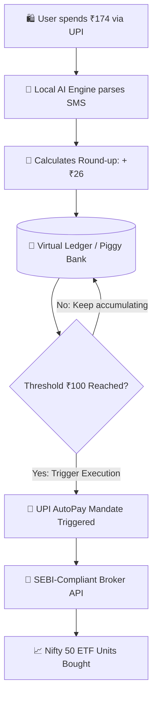

# RupeeRound-Core
"Which is easy: ordering food or investing?" What if they were the exact same action? RupeeRound uses local AI to intercept your daily consumption, round up the spare change, and silently auto-invest it into compounding equity.

# 🚀 RupeeRound 
**Automated Micro-Investing & Stock-Back Engine for ALL**

## 📌 The Problem
People spends billions on Swiggy, Zomato, and Amazon, but their retail investing is crippled by procrastination and high capital friction. Traditional cashback yields "dead rewards" (coupons that expire). 

## 💡 Our Solution
RupeeRound intercepts daily spending and turns consumption into long-term compounding assets via two pillars:
1. **Automated Round-Ups:** Spend ₹174 → Round up to ₹200 → Save ₹26 in a virtual ledger.
2. **Stock-Back Rewards:** Merchant affiliate commissions are converted into fractional Nifty 50 ETF units instead of useless coupons.

### 📱 Product UI
Product UI Demo : 
https://22vishal18.github.io/RupeeRound-Core/RuppeeRoundUIdemo.html

## ⚙️ Technical Architecture (How it Works safely)
To ensure optimal unit economics (avoiding ₹12 gateway fees on ₹4 investments) and regulatory compliance (no illegal fractional shares), we built a 4-step pipeline:

1. **AI-Powered SMS Detection:** Uses Google GenAI (Gemini/Gemma models) locally to parse bank SMS texts, extracting only the merchant and amount to protect user privacy.
2. **Virtual Ledger Batching:** Micro-deltas are held virtually until they hit a **₹100 threshold**.
3. **UPI AutoPay Sweep:** At ₹100, a pre-authorized UPI mandate autonomously sweeps the funds.
4. **SEBI-Compliant Routing:** Capital is strictly routed into Index and Liquid ETFs via broker APIs.

## 🤖 The AI SMS Parser (Code Proof)
Instead of brittle Regex, our backend uses a Generative AI parser to understand unstructured bank transaction texts. 
*(See `ai_parser.py` in this repository for the live execution script).*

## 🤝 Hacktoberfest Contributions
We are open-sourcing our core SMS-Parsing engine. We are actively seeking community contributions to build out parsers for regional Indian banks (SBI, PNB, ICICI). Please check our **Issues** tab for `good first issue` tags!
